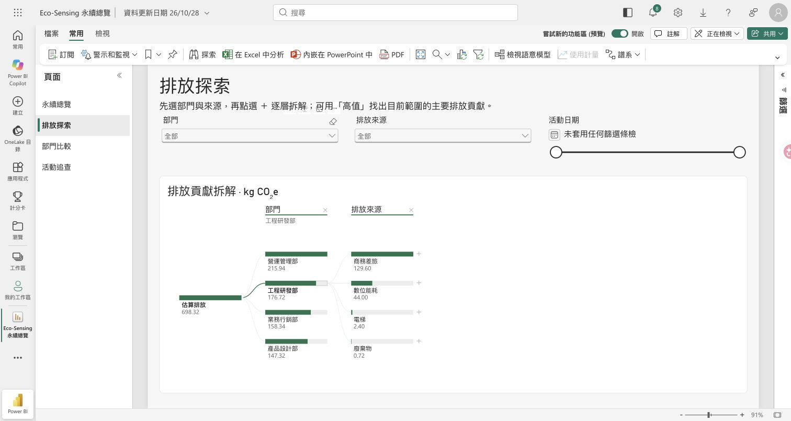
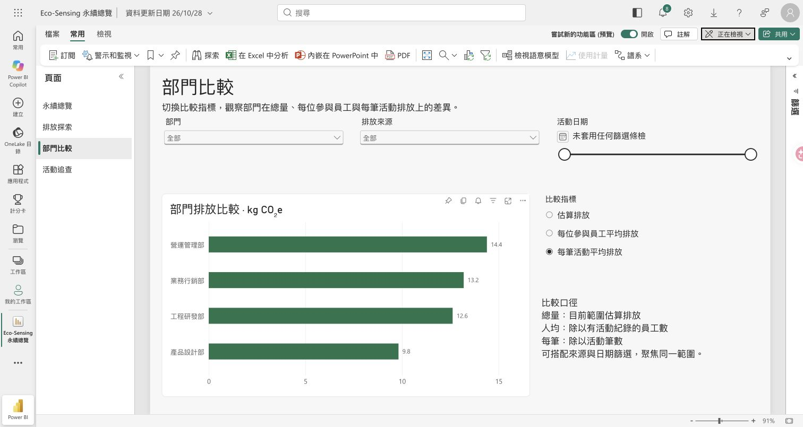
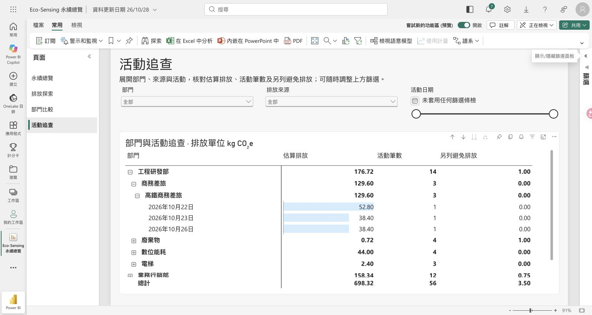

# Eco-Sensing：Power BI 展示操作

本次修改直接儲存在既有 Power BI Service 報表與語意模型；原本的「永續總覽」保留，新增三個可操作頁面。沒有新增應用程式後端，也沒有開啟「發佈至網路」或變更報表權限。

## 報表入口

[開啟排放探索](https://app.powerbi.com/groups/me/reports/290cb312-a19d-468f-bbd1-b1db5d0a28a9/4445a808d0150ead2320?experience=power-bi)

報表已將「排放探索」設定為登陸頁面。既有網址若明確指定原總覽頁，仍會開啟原總覽。

網站：企業端 → Power BI 報表 → 變更報表，貼上上述網址並儲存。網址只保存在該瀏覽器；換瀏覽器或清除網站資料後需重新設定。HTTPS 網站可按「在此檢視報表」，也可直接另開 Power BI；需要具有原報表權限的 Microsoft 帳號。

## 已完成的分析

| 頁面 | 可實際操作的內容 | 展示重點 |
| --- | --- | --- |
| 排放探索 | 部門／來源／日期篩選、分解樹、原生「高值／低值」拆解 | 從總排放找出主要貢獻，再選擇部門、來源或活動繼續拆解 |
| 部門比較 | 原生欄位參數切換總量、人均及每筆活動平均排放，依範圍重算 | 避免只用總量比較；切換口徑後，排序可能改變 |
| 活動追查 | 矩陣逐層展開部門 → 來源 → 活動 → 日期、資料橫條 | 從彙總追查日期，並列估算排放、活動筆數與避免排放 |

「高值」分析的是目前範圍的排放貢獻，不代表已證明因果關係。人均分母是篩選範圍內有活動紀錄的相異員工，不是全體在職人數。避免排放獨立呈現，不折抵估算總排放。

## 約 75 秒的錄影順序

1. **0–10 秒：從網站進入 Power BI。**「員工的行動紀錄可以進一步提供主管分析。這裡使用真正的 Power BI 報表，查看不同部門與來源的排放。」
2. **10–30 秒：排放探索。**在節點旁按 `＋`，選「高值」或「排放來源」。「透過分解樹，我們能從總量繼續拆解，找出目前範圍中貢獻較高的部門、來源與活動。」可切換工程研發部，展示總量跟著變更，再恢復全部。
3. **30–50 秒：部門比較。**先選「估算排放」，再選「每筆活動平均排放」。「除了總量，也能切換人均與每筆活動平均。比較口徑不同，部門排序也會改變，讓主管判斷改善優先順序。」
4. **50–70 秒：活動追查。**依序展開工程研發部、商務差旅、高鐵商務差旅。「發現問題後，可以逐層追查到日期，核對排放與活動筆數；避免排放另列，避免混淆計算。」
5. **70–75 秒：結尾。**「讓永續資料從日常紀錄，轉成可以比較、探索與追查的管理依據。」

錄影前可在 Power BI 上方按「全螢幕」。切換頁面後等圖表更新，再進行下一個操作；不要把載入中的畫面錄成結果。

## 已核對的結果

本次驗證使用雲端既有 56 筆資料：估算排放 698.32 kg CO₂e、參與員工 12 人、另列避免排放 3.50 kg CO₂e。

| 部門 | 估算排放 | 每位參與員工平均 | 每筆活動平均 | 活動筆數 |
| --- | ---: | ---: | ---: | ---: |
| 營運管理部 | 215.94 | 71.98 | 14.396 | 15 |
| 工程研發部 | 176.72 | 58.9067 | 12.6229 | 14 |
| 業務行銷部 | 158.34 | 52.78 | 13.195 | 12 |
| 產品設計部 | 147.32 | 49.1067 | 9.8213 | 15 |

已實際驗證：人均及每筆指標切換、每筆指標時業務行銷部排名超過工程研發部、工程部門篩選後分解樹重算為 176.72，以及矩陣展開到三筆高鐵活動日期（10/22、10/23、10/26）。圖表標籤採顯示精度，量值保留原計算值。

## 模型與資料限制

- 六項 DAX 量值定義保存在 [analysis-measures.dax](./analysis-measures.dax)，可在 DAX 查詢檢視核對；目前雲端來源表名為「表格」。
- 原生欄位參數「比較指標」引用估算排放、每位參與員工平均排放、每筆活動平均排放三項量值。
- 雲端資料仍是手動匯入快照。網站新增活動、本站篩選與重設，不會自動更新或重設 Power BI。錄影時請使用 Power BI 畫面內的篩選器。
- 本次沒有建立 Fabric Lakehouse、即時更新、Copilot 或 Data Agent；不要在講稿中宣稱已串接這些服務。
- Power BI 頁面與模型變更已儲存在雲端；此資料夾中的 DAX、操作說明及截圖是維護記錄，不是可直接匯入的 PBIX。

## 實際畫面

